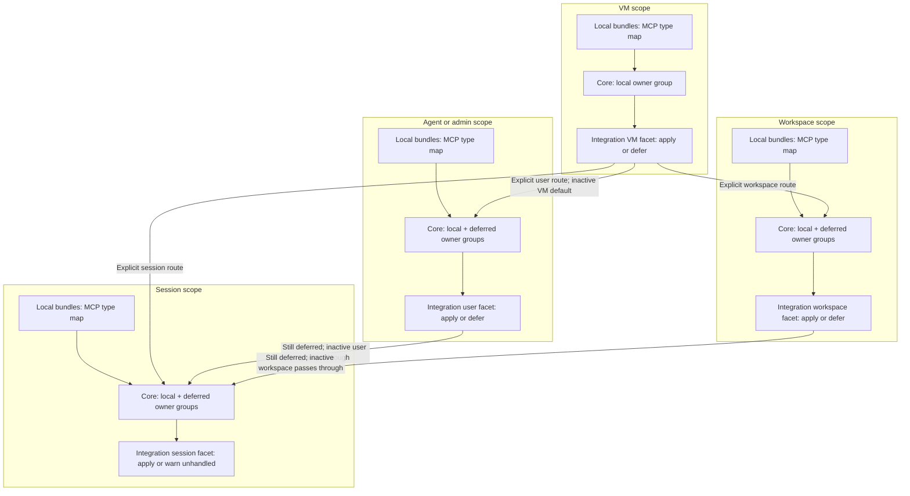

# MCP artifacts: high-level architecture

## Status and choices

Proposed response to the [FRD](frd.md). This checkpoint reviews all SDD artifacts together; it
contains no implementation or permanent claim of MCP support. [Research](prior-art-research.md)
distinguishes current source and native documentation from behavior still requiring live proof.

MCP becomes a fifth artifact type in the existing bundle, capture, routing and application pipeline.
There is no separate MCP resource registry, lifecycle or secret resolver. Canonical connection
definitions stay immutable and unresolved. Integrations choose native registrations; core retains
its existing owner graph and warning policy.

Registration is phase 1. OAuth is phase 2 of this same SDD, with its detailed schema/workflow design
after the first working push. The first PR carries this complete design checkpoint and registration
implementation; a subsequent PR completes OAuth. Phase 1 is useful with env credentials and normal
native authentication, but it does not close or lock the overall effort. See the
[OAuth phase boundary](oauth-phase.md).

## Artifact flow

This diagram concerns artifact flow for one integration and one session's actual ancestors. Each
boundary is a resource scope; the integration runs the named facet. The actual user is an agent or
admin user. Local bundles can enter at every scope. Handled inputs stop at the facet.

Each item takes one route. Core does not duplicate a VM entry across the user/workspace diamond,
merge original owners or infer a downstream activation. One VM result can serve many users and
workspaces independently. Env preparation remains separate and precedes integration invocation. This
effort adds no feature execution between core and integrations.

## Canonical boundary

`artifact-bundle.mcp_servers` uses ordinary per-key whole-entry replacement. Entries select either a
structured inline definition or a workstation/Git source. A source is a JSON/JSONC document with
`mcpServers`; the artifact key selects its same-named server. Existing package acquisition supplies
bounds, revision provenance and refusal behavior. Only the selected normalized definition enters the
pipeline, not the document's unselected server bodies.

The profile borrows shared Rulesync fields for explicit transport, executable/arguments, env and
URL/headers. It rejects tool filters, approval controls, OAuth automation, native passthrough blocks
and unknown structure. [The LLD](mcp-lld.md) fixes the accepted shape and error boundaries. There is
no Rulesync runtime dependency and no promise to accept its entire expanding schema.

Normalized MCP definitions join the existing content identity, original owner and replacement
provenance. Existing four-type identities remain unchanged. The capture codec gains an explicit new
version with retained supported legacy reads; declaration fingerprints omit the new empty map for
legacy-equivalent bundles. [Migration](migration-strategy.md) specifies these compatibility
requirements before any format changes land.

## Credentials

Use the owner's ordinary env declarations, including env entries backed by declared secrets. MCP
content carries variable names rather than a second class of secret references. Capture still occurs
before eager secret resolution. Integrations translate the supported reference forms into native
runtime forwarding/interpolation, without putting resolved values into config overrides, captured
content, ownership records or diagnostics.

The small portable grammar supports same-name stdio forwarding, a complete HTTP header value from
env and bearer authorization from env. It does not introduce a shell/template language. Outer facets
validate representation and retain unresolved names; absence from their own setup env says nothing
about a future user's runtime env. It does not defer a valid workspace registration. For
session-local inputs, the actual managed-launch env permits missing-name diagnostics. The native
client owns runtime binding errors for already-handled outer registrations; no new upstream launch
gate or probe is introduced. Unrepresentable definitions remain wholly unhandled. Native provider
credential restrictions and externally launched processes retain their limits. Dedicated MCP env
names are the recommended operator path.

## Native placement

The placements below are documented candidates for implementation and acceptance, not live claims.

| Integration | VM                    | User                     | Workspace                    | Session, explicit opt-in                            |
| ----------- | --------------------- | ------------------------ | ---------------------------- | --------------------------------------------------- |
| Claude Code | Defer to user         | Native user MCP document | Project `.mcp.json`          | Private MCP config plus invocation flag             |
| Codex       | Defer to user         | Native user config table | Trusted project config table | Invocation-only config overrides                    |
| Grok        | Defer to user         | Native user config table | Native project config table  | Private MCP-bearing plugin, subject to native proof |
| Shell       | Canonical files/index | Canonical files/index    | Canonical files/index        | Private canonical files/index                       |

Use the actual native home and current owner destinations, under existing guarded file APIs. Do not
guess a root/global registration or write configuration into arbitrary filesystem locations. Session
registration is disabled by default under the existing conservative artifact policy. Prove each
opt-in carrier on fresh and resumed starts and with another session present before advertising it. A
mechanism that fails that proof stays explicitly unsupported; it cannot fall back to a user/project
write. Normal native approval, trust and authentication remain in force.

## Shared config and ownership

Whole-file artifact ownership fits private session files and Shell publication. It does not fit one
table inside a shared native document. Outer native setup therefore reconciles the MCP table using
existing native claims, checkpoints, parsers/serializers and expected-content file writes. The unit
of ownership is a server entry. A small MCP-specific helper is sufficient; a general config mutation
framework is outside this design.

Native names are deterministic and qualified by original owner, independent of receiving facet,
bundle and content revision. Identical unowned entries can be adopted. Different unowned entries are
skipped with specific reasons. Owned entries converge; obsolete entries are removed only when their
recorded fingerprint still matches. Preserve modified obsolete entries and retry evidence. Current
context determines file authority, never a stored destination alone. Do not call native remove
commands that also erase OAuth state.

Codex settings mappings can already write `mcp_servers`. Plan mapping and canonical contributions
together before publication. For a managed identity, identical contributions agree; differing
explicit contributions skip that canonical entry with a clear conflict diagnostic. Plan prior claims
and removals too: compute one final document from safe MCP retirements and the selected mapping
policy, preserving its original file-existence decision. If a mapping supplies an entry after
canonical withdrawal, retain it and release the artifact claim after confirmation. A source entry
suppressed by `merge-preserve` in the initial snapshot can become applicable during that same plan;
it must not disappear until a second reinit. Unrelated mapping keys retain their selected strategy.
Mapping removal alone retains current values; explicit MCP lifecycle changes still apply to
MCP-owned units. No execution-order accident or blanket MCP settings ban is needed.

All adapters must explicitly handle or defer the fifth type. Existing render loops otherwise
silently omit a new type while reporting it handled. Successful entry registrations join ordinary
handling results; failures defer only their entries and preserve partial claims. No new
acknowledgment ledger or readiness gate is introduced.

## Lifecycle and diagnostics

User/workspace setup captures, prepares env and invokes integrations as today. Reinit reconciles
entries and retires removed owned effects; independent facets continue after recoverable failures.
Session setup stages prospective-run private files before teardown. A refusal or staging failure
before teardown preserves the working runtime and its effects. After confirmed teardown, a native
launch failure retains accurate retry/cleanup state without claiming rollback of the old runtime.
Keep artifact/run-ID commit after teardown and preserve conditional runtime reconciliation errors.
Restart/resume repeats the chosen invocation-only additions. Cleanup never restores old whole
documents or deletes native credential caches.

`agw artifact show` projects declaration, capture, original owner, native identity, destination and
recorded handling. It shows no connection body and never invokes native inventory that may connect
to servers. Applying/deferring output uses the existing per-type naming and truncation convention.
Registration is not endpoint health, tool discovery or model cooperation. Endpoint deduplication and
cross-harness catalog discovery are native limits, not claims of isolation by name.

Permanent artifact/integration guides, examples and sample/schema teaching ship with implementing
code. [Acceptance](acceptance.md) requires source-pinned native evidence and independent cleanup; an
SDD lock follows actual completion, never this design checkpoint.
