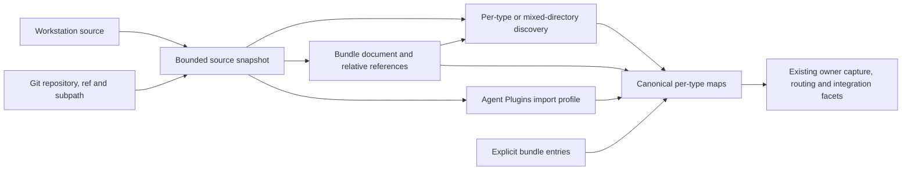

# Artifact bundle sources: high-level architecture

## Approach

Respond to the [draft requirements](frd.md) with one ingestion boundary in front of existing
capture. Acquisition supplies a stable source tree; discovery or a bundle document selects entries
from it; canonical normalization supplies the existing artifact maps. Native integration facets see
the same owner groups as today.

This diagram shows source processing, not scope propagation or persistence. Every owning scope can
select a named bundle; no source is intrinsically VM-, user-, workspace- or session-scoped.

## Source context and relative references

A reference has a source context: workstation or repository identity, the selected root, the
declaring document's directory and, for Git, its already resolved commit. Carry that context with
declarations through inheritance. Replacing an entry replaces its source context too; inheriting one
preserves its original base. Never flatten relative strings and later resolve them against the last
child document.

Use the existing workstation capture boundary and Git object reader. Git ingestion does not need a
working checkout or execute repository code. Resolve each repository/ref once per operation and read
its definitions, discoveries and relative members from those committed objects. Normalize relative
references against their source context; do not turn them into independent floating Git fetches.
Explicit cross-repository references acquire their own context within the same budgets.

Imported definitions cannot use absolute workstation paths or home expansion to read the importing
operator's files. Local operator-authored definitions can retain explicit absolute workstation
sources. Source text is data: loading it grants no commands, resource registration or integration
activation.

The containment boundary and existing-path migration remain explicit review decisions below. Local
directory snapshots retain the current changed-during-capture checks; they do not promise a
filesystem transaction.

## Discovery profiles

Keep explicit format selection rather than guessing from whichever files happen to coexist. A
single-type directory profile takes an artifact type; a mixed Agentworks directory profile uses the
following proposed layout:

| Location                  | Discovery and canonical name                                                                  |
| ------------------------- | --------------------------------------------------------------------------------------------- |
| `hints/*.txt`             | One hint per immediate file, keyed by filename stem                                           |
| `rules/*.md`              | One canonical rule per immediate file, keyed by filename stem                                 |
| `skills/*/SKILL.md`       | One complete standard skill per immediate child directory; directory and metadata names agree |
| `agents/*.md`             | One persona per immediate file; filename stem and metadata name agree                         |
| `mcp.json` or `mcp.jsonc` | All named canonical MCP entries; both present is an ambiguity error                           |

Single-type discovery uses the corresponding row's member rules. Skill support files belong to that
skill; they are not recursively discovered as more artifacts. Absent type directories in a mixed
package mean an empty map. An explicitly selected missing directory is an error. Malformed entries
in a selected canonical location fail capture; unrelated root files are not artifact candidates.

Agent Plugins is a separate import profile, not an alternative spelling for this five-type layout.
Its published version supplies fixed skill and MCP locations. Unknown extension content does not
become Agentworks rules, hints or agents by inference. See [research](prior-art-research.md).

## Authoring and composition

Retain the five explicit type maps. Add one source-selection surface to a bundle, capable of
selecting a directory profile or importing a definition file. Keep the ordinary local wrapper's
resource name authoritative; imported document or plugin names do not create native prefixes. Use
existing bundle inheritance and ordered owner selection for composition rather than inventing a
second dependency graph in the first push.

The LLD must settle exact YAML and whether multiple imports are needed inside one bundle. If an
ordered source collection is used, it must explicitly document inheritance and replacement; it must
not accidentally repeat the activation-list inheritance defect. This checkpoint does not publish an
unreviewed schema as settled configuration.

Imported/discovered maps are the bundle's base and explicit entries override them. Child bundle
entries replace parent entries; later selected bundles replace earlier entries, then owner direct
declarations apply if that feature has landed. Preserve existing diagnostics and complete-entry
replacement. Reject ambiguous discovery within a source instead of using filesystem traversal order
as precedence. Source adapters do not add per-resource namespaces inside an owning scope.

## Capture, state and inspection

Extend the existing bounded acquisition operation, not each harness adapter. Enforce member, byte,
storage, depth and time limits across the whole owner operation, including definition documents and
discovery. Detect nested-import cycles by source/commit/document identity. Parsing a document never
executes its content or reads an arbitrary workstation path supplied by a remote definition.

Only a successful complete normalized group replaces the owner's captured inputs. Existing applied
state then handles changed or withdrawn entries idempotently. Source acquisition failures preserve
the previous capture as historical evidence, not as a successful fallback.

The capture model must retain enough source provenance to explain definition and discovered-member
selection after temporary acquisition storage is gone. Preserve old explicit-only fingerprints and
supported capture reads; version persisted structures only if their interpretation actually changes.
Inspection uses captured discovery results. It can report a changed local declaration without
fetching a branch or rescanning a directory, and cannot claim that recorded members are the latest
remote inventory. No new strict ancestor-freshness gate is introduced.

## Decisions before implementation

1. **Containment and imported inheritance.** Recommend treating a directory source as a package
   boundary. A standalone imported definition uses its containing directory as the boundary, with
   relative members underneath it. Paths escaping that boundary are rejected; independent Git
   sources remain explicit. Decide whether repository-contained sibling paths should instead be
   allowed. Also decide whether imported `inherits` may reference workstation registry bundles or
   whether self-contained definitions compose through source references only. The implementation
   must not guess. Existing ordinary local relative paths currently use process cwd; moving them to
   the declaring file requires a documented migration, not a silent fallback.
2. **Agent Plugins MCP profile.** Skill discovery can use the ordinary skill pipeline. MCP may
   additionally require installed package files, a package working directory and persistent package
   data. Current canonical MCP records do not carry that lifecycle. Either design that support
   deliberately or accept only an explicitly bounded import profile and reject unrepresentable
   servers. Do not drop `cwd` or bind native execution to a temporary workstation acquisition path.
   This question does not reopen the separate OAuth work or authorize native plugin installation.
