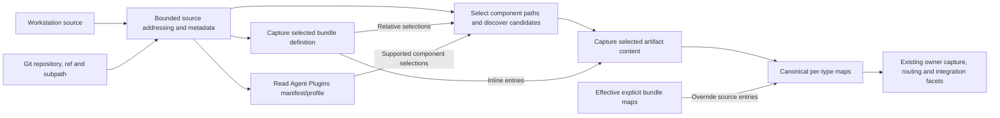

# Artifact bundle sources: high-level architecture

## Approach

Respond to the [draft requirements](frd.md) with one ingestion boundary in front of existing
normalization. Resolve source addresses, select component locations and discover candidates before
capturing their content. A whole-directory layout is shorthand for those same per-type selections.
Native integration facets receive the existing owner maps.

This diagram shows source processing, not scope propagation or persistence. Every owning scope can
select a named bundle; no source is intrinsically VM-, user-, workspace- or session-scoped.

## Relative references

A relative reference retains the base of the document that declared it, including through
inheritance. Prefer normalizing references once when that document is interpreted: local paths
become file-relative source addresses; Git members retain their repository, document directory and
requested ref. Normalization is lexical and does not read artifact content or follow filesystem
links. Never flatten raw relative strings and then resolve them against the last child document.

Use the existing workstation capture boundary and Git object reader. Git ingestion does not need a
working checkout or execute repository code. Resolve each repository/ref once per operation and read
its definitions, discoveries and relative members from those committed objects. Rewritten member
addresses reuse that operation's repository/ref cache; they must not resolve a floating ref again.
Explicit independent Git sources remain within the same acquisition budgets.

Git-imported definitions cannot use absolute workstation paths or home expansion to read the
importing operator's files. Local operator-authored definitions, including explicitly imported local
documents, can retain absolute workstation sources. Any permitted nested operation retains its
Git-origin restriction. Source text is data: loading it grants no commands, resource registration or
integration activation.

Phase 2 applies the same file-relative interpretation to artifact references in bundles and owner
templates, including `artifacts.declare` after PR 908. Their shared `ArtifactDefinitions` remains
explicit maps; only `ArtifactBundle` gains collection-source selection. Define the transition for
existing relative strings, stored instance overlays and declarations without a file base before
implementation. Preserve authored/reference provenance where normalization changes the resolved
view. There is no silent cwd fallback. Containment remains an operator decision below.

Local capture retains changed-during-read checks and must check observed changes to candidate
selection. It does not promise an atomic filesystem transaction across the collection.

## Discovery profiles

Keep explicit format selection rather than guessing from whichever files happen to coexist. A
single-type selection takes an artifact type. A mixed Agentworks directory expands the following
proposed layout into the same per-type discovery path:

| Location                  | Discovery and canonical name                                                                  |
| ------------------------- | --------------------------------------------------------------------------------------------- |
| `hints/*.txt`             | One hint per immediate file, keyed by filename stem                                           |
| `rules/*.md`              | One canonical rule per immediate file, keyed by filename stem                                 |
| `skills/*/SKILL.md`       | One complete standard skill per immediate child directory; directory and metadata names agree |
| `agents/*.md`             | One persona per immediate file; filename stem and metadata name agree                         |
| `mcp.json` or `mcp.jsonc` | All named canonical MCP entries; both present is an ambiguity error                           |

Select those locations before content capture. The existing root reader rejects `.git`, links and
submodules and counts every selected blob; a repository-root capture followed by filtering cannot
implement this layout. Bounded metadata enumeration identifies candidates, then the existing package
reader captures selected files and complete skill directories. Do not loosen package path or link
checks to make root capture succeed.

For text/persona files, discovery considers the documented extension and canonical filename shape;
ordinary neighbors such as `README.md` and `.gitkeep` are not candidates. A skill candidate is an
immediate real directory with `SKILL.md`; a directory without it is ignored. Once selected, invalid
content, name/metadata disagreement or an unsupported link fails canonical capture. Skill support
files belong to their skill, not to recursive artifact discovery. An explicitly selected missing
directory is an error; missing optional locations in the mixed layout are empty maps. A valid empty
collection can retire its previously managed entries.

Agent Plugins is a separate import profile, not an alternative spelling for this five-type layout.
Its published version supplies fixed skill and MCP locations. Unknown extension content does not
become Agentworks rules, hints or agents by inference. See [research](prior-art-research.md).

## Authoring and composition

Retain the five explicit type maps. Propose one optional whole-source selector on `ArtifactBundle`,
capable of selecting a directory profile or importing a definition. Ordinary offline inheritance
resolves that opaque selector and the explicit maps without acquiring its content. Omission inherits
the selector, replacement replaces it completely and null clears it. Multiple collections compose
through existing ordered owner bundle selection; no second source collection or capture-time
inheritance fold is needed.

Capture expands the one effective selector, then overlays the effective explicit maps. Thus a
parent's explicit rule still overrides discovery when a child replaces the source; the child can
replace that explicit rule normally. This is deliberately different from folding discovered entries
under every unflattened inheritance layer. It preserves ordinary bundle inheritance without a
source-leaf exception. The LLD must include this worked precedence case and the exact source schema.

Later selected bundles replace earlier entries, then owner direct declarations apply after PR 908.
Preserve complete-entry replacement, diagnostics and each reference's declaring base. Reject
ambiguous discovery rather than using traversal order as precedence. The local wrapper's resource
name remains authoritative; imported names do not add native prefixes or per-resource namespaces.
This draft proposes the shape; its YAML and operator-facing choices still require design acceptance.

## Capture, state and inspection

Extend the existing bounded acquisition operation, not each harness adapter. Enforce member, byte,
storage, depth and time limits across the whole owner operation, including definition documents and
discovery. Set a definition-import depth limit explicitly. A proposed one-level import can select
directories and artifacts but cannot import another definition, avoiding a second dependency graph
and cycles. If nested definition imports are accepted instead, they require bounded cycle rejection.
Parsing a document never executes it or reads workstation paths supplied by a Git definition.

Only a successful complete normalized group replaces the owner's captured inputs. Existing applied
state then handles changed or withdrawn entries idempotently. Source acquisition failures preserve
the previous capture as historical evidence, not as a successful fallback.

Offline declaration identity covers known selectors, explicit maps and normalized declaring bases.
Imported definition bodies, resolved commits and discovered membership are capture evidence, even
when the imported definition is a local file. Changing a remote branch cannot change offline
identity without acquisition. Preserve old fingerprints for unchanged inline and absolute
declarations; the relative-path transition must specify its identity changes explicitly.

Record each discovered member's own subpath through existing `ArtifactProvenance`. Discovery alone
does not require a codec change. The LLD must establish how imported-definition provenance is
retained after staging is removed; version persisted structures only for a genuine interpretation
change and retain supported older reads.

Inspection explains current selectors and recorded members without fetching or walking sources. A
missing capture has unknown inventory, not a known empty collection. A recorded member absent from
the explicit maps is not automatically a removed declaration. Report the collection's captured
membership and whether selection changed without claiming the current remote inventory is known. No
new strict ancestor-freshness gate is introduced.

## Refresh

New VM/admin source content is captured by authorized `agw vm reinit`; agent content by
`agw agent reinit`. A managed session start/restart captures its own sources. Existing workspaces
have no artifact reinit: use supported recreation when their setup must change, preserving work
first. Descendant setup consumes existing ancestor captures and does not refresh them implicitly.
These operations retain their ordinary authorization and effects; inspection remains read-only.

## Decisions before implementation

1. **Containment and imported inheritance.** The current recommendation, still awaiting operator
   disposition, is normal file-relative local paths and Git-relative paths anywhere inside the
   pinned repository, including `../skills` from `team/bundle.yaml`. Reject escape past that root;
   do not add a definition-directory boundary. Agent Plugins retains its format's package boundary.
   Also recommend rejecting imported workstation-registry `inherits` and nested definition imports
   initially; the local wrapper can use ordinary registered inheritance/ordered bundle selection.
   The operator can choose a different import contract before implementation. Existing cwd-relative
   artifact strings need a documented migration to the proposed shared file-relative interpretation.
2. **Agent Plugins MCP profile.** Skill discovery can use the ordinary skill pipeline. MCP may
   additionally require installed package files, a package working directory and persistent package
   data. Current canonical MCP records do not carry that lifecycle. Recommend an initial profile
   importing skills and compatible Streamable HTTP registrations while explicitly rejecting stdio.
   This recommendation remains unanswered; full stdio support requires an explicit package/runtime
   design and scope decision, not an accidental extension of ingestion. Do not drop `cwd` or use a
   temporary workstation path as a native runtime location. This question does not reopen separate
   OAuth work or authorize native plugin installation.
