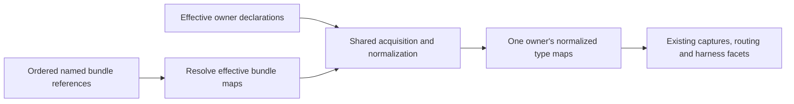

# Direct artifact declarations: architecture

## Shape and flow

Extend the existing owner-side `ArtifactsConfig` with a nullable `declare` content object. Extract
the five type maps and their iteration into one shared schema used by that object and named
`ArtifactBundle` resources. The content schema has no resource identity or bundle inheritance.
Artifact entry schemas keep whole-entry replacement; their containing maps use the ordinary
schema-directed key merge. A null content object replaces the inherited value and can later be
followed by a newly authored object.

Bundle content reaches capture first; direct content follows last in the same capture operation.
Both use existing artifact entry validation, normalization, accounting and source acquisition.
Capture continues to produce the existing immutable `ArtifactGroup` and `ArtifactInput` values.
Different original owners remain separate when deferrals meet at a receiving facet.

## Provenance and state

The actual consuming instance remains the artifact owner, including when declarations are inherited
from templates. A named bundle remains source-selection provenance. Use the existing empty bundle
field for owner-declared content and render that absence explicitly as direct declaration; do not
register a synthetic resource or reserve an operator-visible name. Acquisition provenance remains
independent: `inline` describes content authored as bytes, while workstation/Git sources retain
their normal evidence.

The declaration fingerprint includes effective direct definitions only when nonempty. Preserve the
existing exact bundle-only digest input when direct content contributes nothing. Existing input
hashes, content hashes, capture versions and native claims stay unchanged. Removing direct content
uses ordinary owning setup and cleanup; there is no new state store or lifecycle operation.

Inspection projects declarations through the same effective selection order as capture without
opening sources. Keep named-bundle contribution fields meaningful and add a small explicit indicator
for direct contribution/selection where needed. Captured provenance describes captured content;
current declaration selection describes current intent. A stale capture must not falsely turn direct
content into an undeclared artifact or claim new content was captured.

## Validation and delivery

Boundary tests cover all five types, every owner resolver, template and instance null/empty
behavior, whole-entry override, normalized identity, legacy fingerprint stability, capture bounds
and offline inspection. Existing schema extraction/emission and resource graph paths must expose the
new input without creating a bundle dependency for direct content. Representative lifecycle tests
prove delivery and removal use existing routing and claims.

This follows the repository's established bundle and schema-merge patterns; no new external format
or dependency is introduced, so separate prior-art research is unnecessary. The additive transition
is described in `migration-strategy.md`. This architecture and the implementation ship together.
