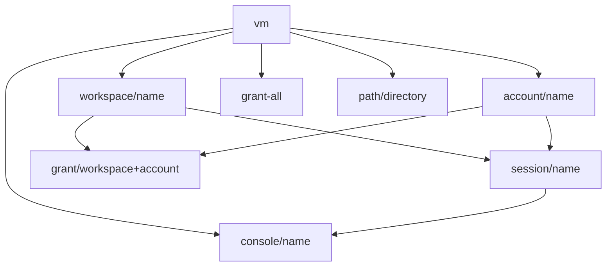

# Native lock hierarchy: high-level architecture

Status: draft. The [FRD](./frd.md) is accepted (2026-11-23); the [LLD](./lock-lld.md) carries the
detail.

## Today

`native_mutation_guard` (`cli/agentworks/harness_setup/locking.py`) takes one exclusive,
non-blocking lock per VM: `flock(LOCK_EX | LOCK_NB)` on POSIX and a one-byte `msvcrt.locking` on
Windows, on `<db dir>/.<db name>.native-locks/<sha256(vm name)>`. A nested operation reuses its
caller's guard through `held=`. About 40 sites acquire it, among them every VM, agent, workspace,
session and console mutation and `runtime_state`'s family selection, which locks every selected VM
in name order.

Two acquisitions do most of the damage the FRD describes:

- `LiveVMNode.hold_active` (`vms/nodes.py`) takes the lock to admit every gated command, access
  commands included, then releases it before the body runs. So `vm shell`, `vm exec`, `agent shell`,
  `session attach`, `session logs` and `vm port-forward` fail while anything holds the VM.
- Every long mutation holds the whole VM: `vm reinit` and `vm create` for many minutes, a workspace
  clone or rehome for up to ten, agent create for a minute.

Some mutators take no lock on their body (agent revoke, workspace copy's source,
`vm import-host-keys`, `vm confirm-release`). Several prompts run while the lock is held (rekey's
auth key and its share pause, recover's host-key confirmation, rehome's confirmation, session
delete's confirmation, console delete's confirmation and the empty-console offer, spec restart
consent, and console attach's gate secrets).

## Shape

### Entities and their tree

Locks name entities within one VM, and every entity has a fixed set of parents:



- **vm**: the VM itself: power, provider state, trust records, VM-wide initialization.
- **workspace** and **account**: a workspace directory with its group, and an account on the VM (an
  agent's, or the admin's). An account's lock covers the account, its home, its socket directory and
  its harness setup, whose native tool home must lie inside that home
  ([Shared state across entities](#shared-state-across-entities-r5)).
- **session**: one session, below both its workspace and its account.
- **grant**: one agent's membership in one workspace's group, below both. Grant and revoke, the
  implicit grant of session create, and grant-all materialization lock it.
- **grant-all**: the set of agents granted every workspace. Workspace create reads it, to grant
  those agents the new workspace, so it holds it shared; agent create with grant-all and grant or
  revoke `--all` change it, so they hold it exclusive, together with a grant for every existing
  workspace and the account shared even when there are none: revoke `--all` deletes every grant row
  of the account, so it must exclude a named grant that lands meanwhile.
- **path**: a workspace directory tree on the guest, by its resolved path, with each ancestor
  directory as its parent (see Workspace directory paths below).
- **console**: a named console. It holds sessions from anywhere on the VM, so a console operation
  locks the console and marks each member session in use.

### Two modes

An operation takes **exclusive** on each entity it changes and **shared** on every ancestor of those
entities. That is all of R2:

- Lower blocks higher: a session change holds its workspace and account shared, so a workspace
  change, which needs the workspace exclusive, is refused, and so is anything VM-wide.
- Higher blocks lower: a workspace change holds the workspace exclusive, so a session start in it,
  which needs that workspace shared, is refused.
- Unrelated subtrees proceed: two session starts in different workspaces for different agents share
  only the VM, and both hold it shared.

Because a session has two parents, exclusive on one parent does not cover it: a workspace change and
an agent change could otherwise both reach a session in that workspace for that agent. So an
operation that changes descendants it finds (workspace delete and agent delete remove sessions,
grants and console windows) takes each of them exclusive too, and with them every ancestor it does
not already hold, shared. Workspace delete then needs the session's account shared, which a
concurrent agent delete holds exclusive, so one of the two is refused.

An access or observe command (R4) takes the **vm** shared for its admission only, as `hold_active`
does today, and runs its body (the shell, the attach, the forward) unlocked. Only a VM-wide
operation, which takes the vm exclusive, refuses it. Holding the vm shared for the body would refuse
`vm stop`, `reinit` and `delete` for as long as any shell stayed open.

Booting a stopped VM is a VM-wide change, and a held shared lock cannot be upgraded (neither `flock`
nor `LockFileEx` converts one safely). Every command keeps today's activation order (ADR 0019) and
changes only where its lock is taken:

1. **Read:** the database reads that build its lock set, including any chooser that picks the
   target.
2. **Probe:** try the whole set without waiting and release it at once, so a conflict fails before
   any later prompt or boot (R3).
3. **Confirm early:** the confirmations that today precede the gate (workspace, agent and vm
   delete).
4. **Gate:** gate secrets just in time, skipped when the VM is confirmed active; a boot, only when
   the operation needs the VM running and the provider reports it stopped, holding the vm exclusive
   for the boot alone; then the availability hold (a keepalive, not a lock) to the end.
5. **Prepare:** the preflight sweep, guest probes, boundary secrets, and the confirmations that show
   what the probes found. Nothing is locked yet.
6. **Acquire** the set, with the vm shared.
7. **Re-check** the identity, intent and state read before, refusing if any changed.
8. **Run.**

Commands built on the activation gate run steps 4 and 5 inside it, as today; the probe is a separate
call made after step 1, ahead of any early confirmation. Runtime families keep their own order
within step 4 and 5 (preflight, gate secrets just in time, provider observation and guest status,
boot) and resolve the workload boundary at step 8. A runtime family records its intent under a brief
acquisition of its own set (the vm shared, its targets exclusive) after the probe and before the
gate, then releases it, so the intent survives any later failure as it does today.

An operation needs the VM running when it opens the activation gate today; stop paths do not. So no
vm exclusive outlives a boot, a transient reachability miss on a running VM never takes it, and R4
holds while a long operation runs on a VM it started. A cold boot for an access command still needs
the vm exclusive, so any operation below the VM refuses it, as the single guard does today.

The two modes map onto primitives every workstation has: `flock` `LOCK_SH` and `LOCK_EX` on POSIX,
and `LockFileEx` with and without `LOCKFILE_EXCLUSIVE_LOCK` on Windows (through `ctypes`, since
`msvcrt.locking` has no shared mode). Every acquisition uses fail-immediately (`LOCK_NB`,
`LOCKFILE_FAIL_IMMEDIATELY`).

### Files

The vm level keeps today's file, path and byte: `.<db name>.native-locks/<sha256(vm)>`, one byte at
offset 0 on Windows. An older `agw` still running during an upgrade takes that byte exclusive, which
conflicts with every new holder's shared or exclusive lock on it, so old and new processes still
exclude each other correctly, with the old one simply being coarser. Entities below the VM get files
in a directory beside it, `<sha256(vm)>.d/<kind>-<sha256(name)>`. Files are created on first use and
never unlinked, for the reason today's docstring gives.

Entities are keyed by kind and name within the VM, as the VM is keyed by name today. Creating an
entity locks its name before it exists, which also refuses two creates of the same name at once.
After acquiring, an operation re-checks the identity it depends on (a row's uuid, a session's
workspace and agent), as today's callers re-check `vm_uuid`.

### Acquiring a set

An operation names its whole lock set up front: a list of (entity, mode), built from what it read
before locking. The guard sorts it into one global order (vm, then workspaces, accounts, grant-all,
paths, grants, sessions, consoles, each by name) and takes each lock without waiting. The first
refusal releases what was taken and raises. Because nothing waits, there is no deadlock, and the
fixed order keeps a refusal deterministic.

An operation whose set depends on state (agent delete removes its sessions, grants and console
windows; workspace create grants the grant-all agents) reads that state before locking, includes
what it found, acquires, and re-reads under the set: anything different refuses the operation and
the operator runs it again. Each acquisition takes its whole request, and a set never grows after it
is acquired; a multi-target command may retry without the targets that needed the refused entity in
the refused mode, never adding one. A nested operation receives the held set (today's `held=`) and
may only use entities the set already covers in a mode at least as strong.

### Naming the holder (R3)

Each held set writes a small record beside the lock files, and holds a lock on the record itself for
as long as it holds the set: a start time, the command (`agw` and its subcommand words, never
argument values), the entities and modes it holds, and its pid for diagnosis only. It removes the
record on release. A refused operation reads the records, keeps those whose own lock is still held
and whose set conflicts with what it asked for, and names one:

```text
Error: session/build-42 on VM 'dev' is blocked: `agw workspace rehome` has held workspace/api for 3m12s
Hint: Retry when that operation finishes.
```

A record whose lock is free belongs to a holder that has exited, since the OS releases its locks
then; the next reader ignores and deletes it. Liveness never rests on a pid, which can be reused.
The record is advisory: the OS lock decides, so a missing or stale record only weakens the message
(to today's generic one), never the exclusion. Records carry no secret values or arguments, since
other local processes read them.

### Shared state across entities (R5)

Some writes reach state no single entity owns. Each gets an explicit home:

- **The VM's account and group files.** Every account or group edit Agentworks makes is a single
  shadow-utils command (`useradd`, `usermod -aG`, `usermod -rG`, `userdel`, `groupadd`, `groupdel`),
  and shadow-utils serializes its own tools through `lckpwdf` on both supported guest releases
  (Debian 12 and 13). Each of these locks the files before it reads them, so concurrent edits of one
  group cannot undo each other. `gpasswd -d`, which removes a membership today, reads the group
  before it locks and writes its stale copy back whole, so two removals from one group could restore
  each other's member; removal moves to `usermod -rG`, the tool additions already use, and its
  status is checked, a missing user or group counting as removed. A command that drops an agent's
  last grant on a workspace removes the membership first and deletes the grant row only once that
  succeeds, so a failure leaves the row to retry from. The one check-then-create sequence that can
  now run twice at once, creating a workspace's group during a grant, becomes `groupadd -f`. Agent
  deletion, under the account's exclusive lock, stops the account's processes and refuses if any
  remain, then runs `userdel -r` as today: a configured pre-deletion hook can still veto before
  anything is removed, a mailbox owned by someone else is kept, and the numeric user ID stays
  reserved while `userdel` removes the home (a removal that fails partway leaves what it leaves
  today). One outcome changes: a removal that fails now raises and keeps the agent's row, where
  today it warns and drops the row, so the delete can be rerun. The cost under finer locks is that
  `userdel -r` holds shadow's lock while it removes the home, so a concurrent account edit elsewhere
  on the VM waits on it, and past `lckpwdf`'s 15 seconds fails with a typed error the operator can
  retry; nothing is lost. Holding the vm exclusive instead would refuse access and unrelated
  sessions for the whole removal, against R2 and R4.
- **Native tool homes stay in the account's home.** A harness tool's home can be moved by an
  override (`CLAUDE_CONFIG_DIR`, `CODEX_HOME`, `GROK_HOME`), and plugin and marketplace setup runs
  the native tool's own CLI there, which is not safe to run twice at once on one directory. Today
  only the VM lock keeps two accounts sharing such a directory apart. Instead of locking it, the
  design confines it: a user-level tool writes only inside its user's home, so a tool home that
  resolves outside the account's home, following links, is refused, and that setup reports itself
  incomplete and writes nothing. Two accounts' tool homes then never meet, and the account's own
  lock covers everything its setup writes. Keeping a tool home outside the home, for example to
  share it across agents, is what this gives up; the upgrade guide says to move such an override
  inside the home.
- **VM-wide files written at session launch** (`/opt/agentworks/tmux-session.conf`, the socket
  roots). The configuration is written by an atomic replace, and the socket directories end in the
  same state however two setups interleave, so concurrent launches cannot tear them.
- **The operator's SSH config and the per-VM host-key store.** An SSH config rebuild that read the
  database before another operation committed could write stale entries. This already happens today
  across VMs, since the rebuild takes no lock, and agent creates on one VM now run together too.
  Rebuilds take a per-user workstation mutex with a short bounded wait, and each reads the database
  inside it. Host-key records change only under the vm exclusive. VS Code workspace files are
  written per workspace under that workspace's lock; their bulk regeneration already races today and
  is tracked as #954.
- **Operation logs.** A log is named by VM, start time to the second and command, and opened for
  appending; two operations with the same command starting in the same second, which the single lock
  kept apart, would share one file. Each name gains a unique part and is created exclusively.
- **The guest package database.** Workspace repair's `apt-get` fallback waits on the package-manager
  lock for a bounded time, as recovery's does, since two repairs can now run together.
- **Workspace directory paths.** A target path is reserved with a plain `mkdir`, which reserves only
  that directory, not the tree around it: one rehome could move a workspace inside another that a
  second rehome is about to remove. So directory trees are locked like entities, with a `path` kind
  under the vm. An operation that creates, fills, reads whole or removes a workspace tree takes its
  root exclusive and shared every directory the guest looks a name up in to reach it, found by one
  lookup walk on the guest that follows each link as the kernel does, so links on the way and the
  directories they lead through are dependencies too. Workspace create and copy's destination take
  their target, rehome and copy's source take their source, rehome its target, workspace delete its
  path; the walk runs again under the set to confirm nothing moved. An operation that only removes a
  final entry that is a link locks the entry and its parents without following the link, so a stale
  or looping link can still be deleted; every link the walk does follow is locked shared at its own
  entry too, so deleting that link is refused while an operation runs through it. Delete removes the
  stored path in its normalized spelling, so a stored trailing slash cannot make the removal follow
  a final link into its target. The rehome that would move a workspace into `/data/B/new` holds
  `/data/B` shared, so a removal of `/data/B` is refused while it runs, and work in disjoint trees
  still runs together. A nested layout that already exists keeps today's behavior, including what a
  later `--remove-old` does to it (#957).
- **Stale socket cleanup across one agent's sessions** runs under that account's exclusive lock
  (agent create and reinit) or the vm exclusive (vm reinit and create), so no session of that agent
  is starting meanwhile.
- **Membership** is the grant entity above. Every caller that adds an agent to a workspace group or
  removes it holds that grant exclusive, session delete included when it drops an implicit grant,
  and removes the membership before deleting the last grant row. Grant-all materialization reads the
  grant-all agents (or the workspaces) before locking and takes one grant per pair.

Every mutator takes the lock for what it changes, including those the single guard still misses:
grant and revoke (the grant, with its workspace and account shared), workspace repair and copy's
destination (the workspace), copy's source (its path), and `vm import-host-keys` and
`vm confirm-release` (the vm).

### Prompts before locks (R6)

Secret resolution and confirmations move before acquisition. Where the answer depends on state the
lock keeps stable, the operation reads, asks, then acquires and re-checks the state it showed; if it
changed, it refuses and the operator runs the command again. Three exceptions stay inside the lock,
because the question is about what the locked operation is doing:

- recover's host-key confirmation, which confirms a key the locked recovery just observed;
- rekey's `--wait-for-share` pause;
- workload and console pane secrets in `runtime_state` and console runtime commands, which secrets
  are needed depends on definitions and observations made inside the lock. Their gate secrets do
  not, and resolve before acquisition like every other command's.

The first two hold only the vm, which a VM-wide operation holds anyway. The third holds only the
selected families' sets, one notice per set. Each says so with one notice line before it asks. Only
those acquisitions are marked as prompting; a prompt under any other held set is a programming error
and raises.

Moving a confirmation earlier keeps the order in which a command refuses: the read-only probes that
today run before a confirmation (session delete's status and access checks, rehome's directory
probes) run before it, unlocked, and again under the set. Rehome also re-checks under the workspace
exclusive that no session in it is running.

### Many VMs

`runtime_state` selection and every other multi-target command keep their shape: one lock set per VM
family, acquired in VM name order, a refused family marked failed while the others proceed. Each
family's set now names its targets (sessions, consoles) and their ancestors rather than the whole
VM.

## Where each operation lands

Each operation takes exclusive what it changes and shared every ancestor of it, as above. The LLD's
lock-set table gives every command's set, and its appendix is the line-level inventory at HEAD the
implementation works through; the HLA keeps no second copy of either.

A few cases are worth naming here. Access commands and console attach take the vm shared for
admission only. `vm reconcile` takes what its session and console children need, and the vm
exclusive only when the VM's own target is stopped, which is a stop.
`session create --new-workspace` or `--new-agent` takes that workspace or account exclusive in place
of shared. A runtime command refused at acquisition after it recorded its intent says so and names
`set-desired-state` to undo it.

## What does not change

What each command does, apart from the locks it takes and when it prompts (FRD out of scope). The
lock stays per workstation and per database. Dry runs still take no lock.

## Delivery

Two implementation PRs after the design, stacked and each green on its own:

1. **Under today's single lock:** the shared-state fixes (`groupadd -f`, membership removal through
   `usermod -rG` before the last grant row is deleted, the agent-removal process check before
   `userdel -r` with the row kept when removal fails, workspace delete's normalized path, the SSH
   config rebuild mutex, the bounded package-manager wait, unique operation log names), guards on
   the mutators that take no lock today, and the prompts moved before acquisition. Each is correct
   with the single lock in place, and the SSH config rebuild mutex and the new guards fix races that
   exist today.
2. **The hierarchy:** the new primitive replacing `native_mutation_guard` and its token in one step
   (no old and new lock paths side by side on `main`), every call site moved to its lock set, and
   every doc that describes the single guard updated: `cli/command-reference.md` (the busy
   paragraph), `cli/agentworks/orchestration/README.md`, `cli/agentworks/db/README.md`,
   `cli/agentworks/capabilities/harness_integration/README.md`, the guides on desired runtime state,
   native harness setup, harness facets and idempotency, the troubleshooting guide topic, and the
   upgrade guide. Its tests cover the conflict matrix at the primitive, each mode on both platforms,
   a crashed holder, the old-version interlock, holder naming, and one concurrent pair per FRD story
   driven through real services.
