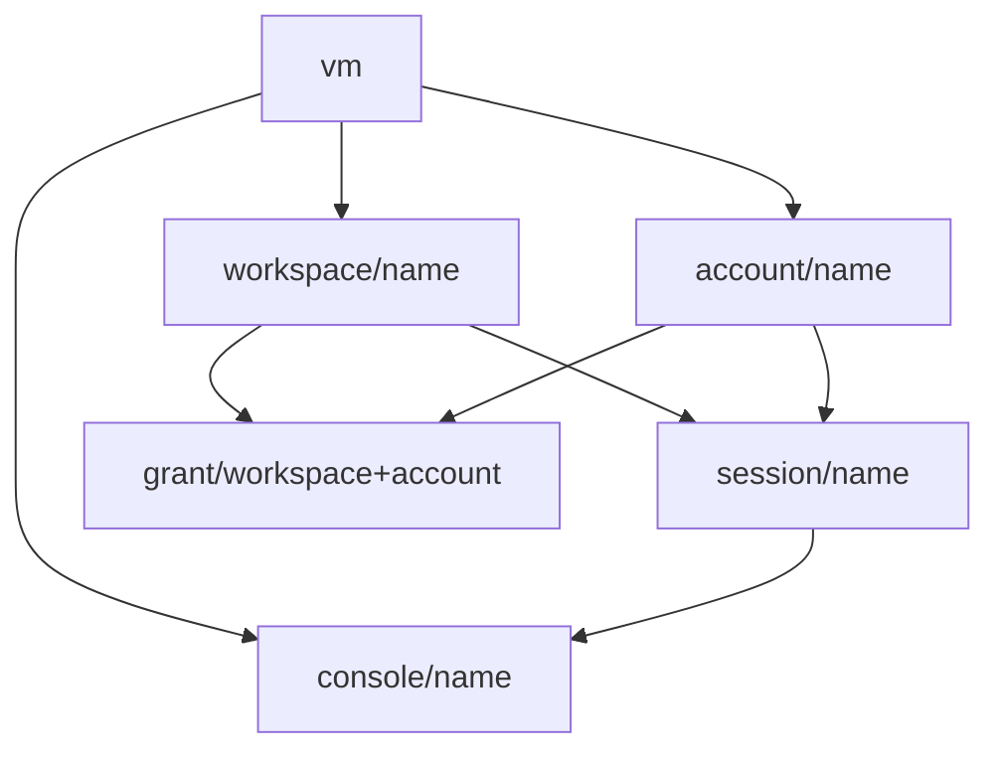

# Native lock hierarchy: high-level architecture

Status: draft. The [FRD](./frd.md) is accepted (2026-11-23).

## Today

`native_mutation_guard` (`cli/agentworks/harness_setup/locking.py`) takes one exclusive,
non-blocking lock per VM: `flock(LOCK_EX | LOCK_NB)` on POSIX and a one-byte `msvcrt.locking` on
Windows, on `<db dir>/.<db name>.native-locks/<sha256(vm name)>`. A nested operation reuses its
caller's guard through `held=`. About 40 sites acquire it, among them every VM, agent, workspace,
session and console mutation and `runtime_state`'s family selection, which locks every selected VM
in name order.

Two acquisitions do most of the damage the FRD describes:

- `LiveVMNode.hold_active` (`vms/nodes.py`) takes the lock to admit every gated command, access
  commands included, then releases it before the body runs. So `vm shell`, `vm exec`, `agent shell`,
  `session attach`, `session logs` and `vm port-forward` fail while anything holds the VM.
- Every long mutation holds the whole VM: `vm reinit` and `vm create` for many minutes, a workspace
  clone or rehome for up to ten, agent create for a minute.

Some mutators take no lock on their body (agent grant and revoke, workspace repair, workspace copy,
`vm import-host-keys`). Several prompts run while the lock is held (rekey's auth key and its share
pause, recover's host-key confirmation, rehome's confirmation, session delete's confirmation,
console delete's confirmation and the empty-console offer, spec restart consent).

## Shape

### Entities and their tree

Locks name entities within one VM, and every entity has a fixed set of parents:



- **vm**: the VM itself: power, provider state, trust records, VM-wide initialization.
- **workspace** and **account**: a workspace directory with its group, and an account on the VM (an
  agent's, or the admin's). An account's lock covers the account, its home, its socket directory and
  its harness setup.
- **session**: one session, below both its workspace and its account.
- **grant**: one agent's membership in one workspace's group, below both. Grant and revoke, the
  implicit grant of session create, and grant-all materialization lock it.
- **console**: a named console. It holds sessions from anywhere on the VM, so a console operation
  locks the console and marks each member session in use.

### Two modes

An operation takes **exclusive** on each entity it changes and **shared** on every ancestor of those
entities. That is all of R2:

- Lower blocks higher: a session change holds its workspace and account shared, so a workspace
  change, which needs the workspace exclusive, is refused, and so is anything VM-wide.
- Higher blocks lower: a workspace change holds the workspace exclusive, so a session start in it,
  which needs that workspace shared, is refused.
- Unrelated subtrees proceed: two session starts in different workspaces for different agents share
  only the VM, and both hold it shared.

Because a session has two parents, exclusive on one parent does not cover it: a workspace change and
an agent change could otherwise both reach a session in that workspace for that agent. So an
operation that changes descendants it finds (workspace delete and agent delete remove sessions,
grants and console windows) takes each of them exclusive too, and with them every ancestor it does
not already hold, shared. Workspace delete then needs the session's account shared, which a
concurrent agent delete holds exclusive, so one of the two is refused.

An access or observe command (R4) takes the **vm** shared and nothing else. Only a VM-wide
operation, which takes the vm exclusive, refuses it. Starting a stopped VM is a VM-wide change, so
an access command that must boot the VM takes the vm exclusive for the boot and drops to shared for
its body.

The two modes map onto primitives every workstation has: `flock` `LOCK_SH` and `LOCK_EX` on POSIX,
and `LockFileEx` with and without `LOCKFILE_EXCLUSIVE_LOCK` on Windows (through `ctypes`, since
`msvcrt.locking` has no shared mode). Every acquisition uses fail-immediately (`LOCK_NB`,
`LOCKFILE_FAIL_IMMEDIATELY`).

### Files

The vm level keeps today's file, path and byte: `.<db name>.native-locks/<sha256(vm)>`, one byte at
offset 0 on Windows. An older `agw` still running during an upgrade takes that byte exclusive, which
conflicts with every new holder's shared or exclusive lock on it, so old and new processes still
exclude each other correctly, with the old one simply being coarser. Entities below the VM get files
in a directory beside it, `<sha256(vm)>.d/<kind>-<sha256(name)>`. Files are created on first use and
never unlinked, for the reason today's docstring gives.

Entities are keyed by kind and name within the VM, as the VM is keyed by name today. Creating an
entity locks its name before it exists, which also refuses two creates of the same name at once.
After acquiring, an operation re-checks the identity it depends on (a row's uuid, a session's
workspace and agent), as today's callers re-check `vm_uuid`.

### One acquisition per operation

An operation names its whole lock set up front: a list of (entity, mode). The guard sorts it into
one global order (vm, then workspaces, accounts, grants, sessions, consoles, each by name) and takes
each lock without waiting. The first refusal releases what was taken and raises. Because nothing
waits, there is no deadlock, and the fixed order keeps a refusal deterministic.

An operation whose set is only known after reading state (agent delete finds its sessions and
consoles; workspace delete finds its sessions and grants) first takes its primary entity, reads,
then extends the held set with the dependents it found. Extending is an acquisition too: it fails
fast and releases nothing already held, so the operation reports the conflict and unwinds as it
would on any other error. A nested operation receives the held set (today's `held=`), and may take
only entities the set already covers in a mode at least as strong, or extend it.

### Naming the holder (R3)

Each holding process writes a small record beside the lock files: its pid, a start time, the command
(`agw` and its subcommand words, never argument values) and the entities and modes it holds. It
removes the record on release. A refused operation reads the records, keeps those whose pid is alive
and whose set conflicts with what it asked for, and names one:

```text
Error: session/build-42 cannot start: `agw workspace rehome` has held workspace/api for 3m12s.
Hint: Retry when that operation finishes.
```

A record whose process is gone is ignored and deleted by the next reader. The record is advisory:
the OS lock decides, so a missing or stale record only weakens the message (to today's generic one),
never the exclusion. Records carry no secret values or arguments, since other local processes read
them.

### Shared state across entities (R5)

Some writes reach state no single entity owns. Each gets an explicit home:

- **The VM's account and group files.** Concurrent `useradd`, `groupadd`, `usermod -aG`,
  `gpasswd -d` and `userdel` from different subtrees would contend for shadow-utils' own lock, which
  gives up after a short retry. Every account or group edit runs inside a guest-side
  `flock /run/agentworks/accounts.lock` with a bounded wait of a few seconds. This is an internal
  critical section around one short command, not an operation conflict, so it waits briefly rather
  than failing fast, and it also covers processes from other workstations.
- **VM-wide files written at session launch** (`/opt/agentworks/tmux-session.conf`, the socket
  roots). These writes are idempotent; the LLD confirms each is an atomic replace or an
  ensure-if-missing, and makes it one where it is not, so concurrent launches cannot tear them.
- **The operator's SSH config and other workstation files rebuilt from the database.** A rebuild
  that read the database before another operation committed could write stale entries. Rebuilds take
  a workstation-wide internal mutex with a short bounded wait, and each rebuild reads the database
  inside it.
- **Stale socket cleanup across one agent's sessions** runs under that account's exclusive lock
  (agent create and reinit) or the vm exclusive (vm reinit and create), so no session of that agent
  is starting meanwhile.
- **Membership** is the grant entity above. Grant-all materialization during agent or workspace
  create extends the set with one grant per affected workspace or agent.

The mutators that take no lock today take the lock for what they change: grant and revoke (the
grant, with its workspace and account shared), workspace repair and copy's destination (the
workspace), and `vm import-host-keys` (the vm).

### Prompts before locks (R6)

Secret resolution and confirmations move before acquisition. Where the answer depends on state the
lock keeps stable, the operation reads, asks, then acquires and re-checks the state it showed; if it
changed, it refuses and the operator runs the command again. Two exceptions stay inside the lock,
because the question is about what the operation is doing: recover's host-key confirmation, which
confirms a key the locked recovery just observed, and rekey's `--wait-for-share` pause. Both hold
only the vm, which a VM-wide operation holds anyway.

### Many VMs

`runtime_state` selection and every other multi-target command keep their shape: one lock set per VM
family, acquired in VM name order, a refused family marked failed while the others proceed. Each
family's set now names its targets (sessions, consoles) and their ancestors rather than the whole
VM.

## Where each operation lands

The LLD carries the full table, one row per command with its lock set, its call sites at HEAD and
the prompts it moves. Its spine, where every row also holds each ancestor of what it names shared (a
console's ancestors being the vm and each member session with its workspace and account):

| Operation                                                                     | Exclusive                                            |
| ----------------------------------------------------------------------------- | ---------------------------------------------------- |
| vm create, reinit, start, stop, delete, rekey, recover, set-desired-state     | vm                                                   |
| vm import-host-keys, confirm-release                                          | vm                                                   |
| vm shell, exec, port-forward, backup; agent shell, exec; session attach, logs | nothing (vm shared)                                  |
| agent create, reinit, delete                                                  | account, plus the grants, sessions, consoles found   |
| agent grant-workspaces, revoke-workspaces                                     | one grant per pair                                   |
| workspace create, delete, repair, rehome; copy (destination)                  | workspace, plus the grants, sessions, consoles found |
| session create                                                                | session, plus its implicit grant                     |
| session start, stop, restart, reconcile, delete, set-desired-state            | session                                              |
| console create, start, stop, restart, delete, membership, add-shell, restore  | console                                              |

`session create --new-workspace` or `--new-agent` takes that workspace or account exclusive in place
of shared.

## What does not change

What each command does, apart from the locks it takes and when it prompts (FRD out of scope). The
lock stays per workstation and per database. Dry runs still take no lock.

## Delivery

One implementation PR, after the LLD. It replaces `native_mutation_guard` and its token in one step
(no old and new lock paths side by side on `main`), updates every call site, and updates
`cli/command-reference.md` (the busy paragraph), `cli/agentworks/orchestration/README.md` and the
upgrade guide. Tests cover the conflict matrix at the primitive, each mode on both platforms, a
crashed holder, the old-version interlock, holder naming, and one concurrent pair per FRD story
driven through real services.
